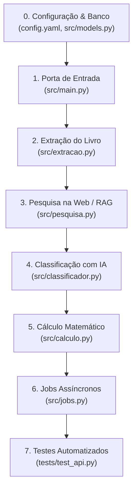

# Mapa do Projeto — Guia para Desenvolvedores Júnior

> **Bem-vindo ao roadmapAPI!**  
> Este documento foi escrito especialmente para quem está começando no projeto ou no desenvolvimento de software. Aqui você vai entender **o que o projeto faz**, **quais tecnologias foram usadas** (e por que foram escolhidas), e **um roteiro passo a passo de como ler e navegar pelo código-fonte**.

---

## 1. O que este projeto faz?

O **roadmap-backend** é uma API que resolve um problema muito comum: *como organizar o estudo de um livro técnico denso de forma realista?*

O usuário envia o sumário de um livro (seja em PDF, arquivo de texto `.txt`/`.md` ou até uma foto da capa), informa o seu nível (Júnior, Pleno ou Sênior) e quanto tempo tem disponível por semana (ou até que data quer terminar).

A API então devolve um **cronograma de estudos semana a semana**, dizendo exatamente:
- Quais capítulos estudar e quais pular (capítulos muito básicos para a sua senioridade são filtrados).
- Quantas horas você deve gastar em cada capítulo (divididas entre leitura teórica, codificação prática e escrita/revisão).
- Em que semana cada capítulo será estudado.

### 🧠 A Regra de Ouro da Arquitetura
> **"A IA julga fatos; o Python calcula a matemática."**  
> Modelos de Inteligência Artificial (LLMs) são excelentes para interpretar texto, extrair títulos e julgar se um capítulo é fácil ou difícil, mas são péssimos em contas matemáticas precisas. Por isso, **nenhuma conta aritmética é feita pela IA**. Toda a fórmula de horas, semanas e divisões é feita em código Python puro, 100% determinístico e à prova de alucinações.

---

## 2. Tecnologias Utilizadas (e para que serve cada uma)

Para construir esse sistema sem custos de APIs pagas na nuvem, usamos um conjunto moderno de tecnologias abertas:

| Tecnologia | O que é? | Para que serve no projeto? |
|---|---|---|
| **Python 3.12** | Linguagem de programação | A base de todo o código do backend. |
| **FastAPI** | Framework web moderno em Python | Cria os endpoints (rotas HTTP) da API. É rápido, tem tipagem forte e gera a documentação interativa do Swagger (`/docs`) automaticamente. |
| **Pydantic** | Biblioteca de validação de dados | Garante que os dados enviados pelos usuários e retornados pelo banco ou pela IA tenham o formato exato esperado (tipagem segura). |
| **uv** | Gerenciador de pacotes e ambientes virtuais | Feito em Rust pela Astral, substitui o `pip` e o `virtualenv`. Instala dependências em milissegundos e trava versões exatas no `uv.lock`. |
| **Uvicorn** | Servidor ASGI para Python | O motor que roda a aplicação FastAPI e escuta requisições na porta `8000`. |
| **PostgreSQL 16** | Banco de dados relacional | Onde guardamos os dados permanentes do sistema (livros, sumários e os roadmaps gerados). |
| **pgvector** | Extensão de vetores para PostgreSQL | Permite fazer busca semântica (RAG). Usado para guardar trechos de páginas da web e achar informações relevantes através de similaridade vetorial. |
| **SQLAlchemy (Async)** | ORM (Object-Relational Mapper) | Faz a ponte entre classes Python e tabelas SQL de forma assíncrona, para não travar a aplicação enquanto espera o banco responder. |
| **Alembic** | Ferramenta de migração de banco | Controla o histórico e evolução das tabelas do banco de dados (criar colunas, tabelas e índices em scripts versionados). |
| **Docker & Docker Compose** | Contêineres de software | Sobe todos os serviços necessários (Postgres com pgvector, Ollama e SearXNG) com apenas um comando (`docker compose up -d`), sem precisar instalar bancos na máquina física. |
| **Ollama** | Executor local de modelos de IA | Roda Inteligência Artificial localmente aproveitando a GPU da máquina, sem pagar OpenAI ou serviços na nuvem. Usamos o modelo `gemma4:12b` para texto e `embeddinggemma` para gerar embeddings. |
| **SearXNG** | Mecanismo de busca na web privativo | Um metabuscador local. Quando o livro enviado não tem número de páginas no sumário, a API usa o SearXNG para pesquisar na internet quantas páginas aquele livro tem. |
| **pdfplumber** | Leitor de PDFs | Extrai texto, posições e números de página diretamente do arquivo PDF enviado. |
| **Pytest** | Framework de testes automatizados | Executa os testes para garantir que tudo funciona como o esperado antes de subir para produção. |
| **Ruff & Mypy** | Linter e verificador estático de tipos | O Ruff corrige estilo e imports; o Mypy garante que nenhuma variável com tipo incompatível passe despercebida. |

---

## 3. Estrutura de Pastas e Arquivos

Quando você abrir o projeto no VS Code ou terminal, verá esta estrutura:

```text
roadmap-backend/
├── config.yaml          # Constantes de cálculo, prompts da IA e regras de negócio
├── docker-compose.yml   # Configuração dos contêineres (Postgres, Ollama, SearXNG)
├── pyproject.toml       # Lista de dependências gerenciadas pelo uv
├── docs/                # Documentações e diagramas
├── migrations/          # Scripts de migração do banco de dados (Alembic)
├── static/              # Interface HTML/JS simples para testar no navegador (GET /)
├── searxng/             # Configurações do buscador SearXNG
├── specs/               # Especificações detalhadas, ADRs e catálogo de requisitos
├── tests/               # Testes automatizados do projeto
└── src/                 # 👉 CÓDIGO-FONTE PRINCIPAL DA APLICAÇÃO
```

---

## 4. Roteiro de Análise: Por Onde Começar a Ler o Código?

Se você abrir todos os arquivos ao mesmo tempo, pode se sentir sobrecarregado. Siga este **roteiro ordenado de 7 etapas** para entender o fluxo naturalmente:



---

### 📍 Etapa 0: A Planta Baixa (Configurações e Tabelas)
*Comece por aqui para entender as regras do jogo e os dados.*

1. **[`config.yaml`](file:///home/mborges/LWH/learning/proj/personal_proj/roadmap-backend/config.yaml) e [`src/config.py`](file:///home/mborges/LWH/learning/proj/personal_proj/roadmap-backend/src/config.py):**
   - Veja como as constantes de tempo (quantos minutos por página, peso por nível de complexidade) e os prompts enviados para a IA ficam todos centralizados aqui.
2. **[`src/models.py`](file:///home/mborges/LWH/learning/proj/personal_proj/roadmap-backend/src/models.py):**
   - O projeto segue uma regra estrita de simplicidade: **apenas 3 tabelas no banco de dados inteiro**:
     - `Book`: Guarda o livro, o título e a lista de capítulos (em formato JSONB).
     - `Roadmap`: Guarda o plano gerado para o usuário (horas, semanas, capítulos).
     - `Chunk`: Guarda trechos de páginas da web com vetor de embedding (usado na busca RAG).

---

### 📍 Etapa 1: A Porta de Entrada da API
*Veja como as requisições chegam da internet.*

- **[`src/main.py`](file:///home/mborges/LWH/learning/proj/personal_proj/roadmap-backend/src/main.py):**
  - É o arquivo onde a aplicação FastAPI nasce (`app = FastAPI(...)`).
  - Procure pelas seguintes rotas principais:
    - `GET /health`: Rota de diagnóstico. Checa se o Postgres, o Ollama e o SearXNG estão saudáveis.
    - `POST /books`: Rota onde o usuário envia o PDF ou TXT do sumário.
    - `POST /books/{book_id}/roadmaps`: O endpoint principal onde o cronograma é solicitado.
    - `GET /roadmaps/{roadmap_id}`: Consulta um cronograma já gerado.
    - `PATCH /roadmaps/{roadmap_id}`: Permite que o leitor ajuste manualmente páginas ou pesos de capítulos sem precisar reconsultar a IA.

---

### 📍 Etapa 2: A Leitura e Extração do Arquivo
*Como um PDF ou TXT vira uma lista organizada de capítulos?*

- **[`src/extracao.py`](file:///home/mborges/LWH/learning/proj/personal_proj/roadmap-backend/src/extracao.py):**
  - Esta etapa não usa IA. Ela usa lógica Python pura para ler o texto do arquivo.
  - O que olhar com atenção:
    - A função `extrair(pdf_bytes)`: Lê página a página com `pdfplumber`.
    - Como o código identifica onde o sumário começa e termina (ignorando prefácio, capa e índice remissivo).
    - Como ele calcula as páginas de um capítulo: subtraindo a página do capítulo seguinte pela página do capítulo atual.
    - Se o sumário não tiver páginas de jeito nenhum (comum em sites de livrarias), ele marca as páginas como `None` e passa a bola para a Etapa 3.

---

### 📍 Etapa 3: A Pesquisa de Fatos na Web (RAG)
*O que fazer quando o sumário não tem o número de páginas?*

- **[`src/pesquisa.py`](file:///home/mborges/LWH/learning/proj/personal_proj/roadmap-backend/src/pesquisa.py):**
  - Se um livro não tem números de página no sumário, não podemos inventar.
  - Veja como essa etapa funciona:
    1. Faz uma busca no `SearXNG` procurando pelo título do livro e editora.
    2. Baixa o texto das páginas encontradas usando a biblioteca `trafilatura`.
    3. Gera embeddings vetoriais desses trechos e guarda na tabela `Chunk` (pgvector).
    4. Pergunta ao Ollama apenas para extrair e confirmar o número de páginas registrado na ficha técnica da editora.
    5. Salva o resultado no campo `book.pesquisa` para nunca mais precisar pesquisar na web aquele mesmo livro.

---

### 📍 Etapa 4: O Julgamento dos Capítulos pela IA
*Quão difícil é cada capítulo?*

- **[`src/classificador.py`](file:///home/mborges/LWH/learning/proj/personal_proj/roadmap-backend/src/classificador.py):**
  - Aqui o Ollama é acionado via prompt estruturado (usando JSON Schema do Pydantic).
  - O modelo recebe apenas:
    - O título do livro.
    - O título de cada capítulo e seus subtópicos.
  - O modelo retorna:
    - O nível do capítulo: `"iniciante"`, `"intermediario"` ou `"avancado"`.
    - Um multiplicador de peso/esforço: um número entre `0.5` e `2.0`.
  - Essa classificação é feita **uma única vez por livro** e gravada no banco (`book.classificacao`). Qualquer roadmap futuro para esse livro é instantâneo!

---

### 📍 Etapa 5: O Motor Matemático (O Coração do Negócio)
*Como o plano de estudos final é montado?*

- **[`src/calculo.py`](file:///home/mborges/LWH/learning/proj/personal_proj/roadmap-backend/src/calculo.py):**
  - **Aqui está a lógica mais pura e elegante do projeto.** Não há chamadas de rede nem banco aqui.
  - Veja as funções principais:
    - `planejar(capitulos, classificacao, senioridade, disponibilidade)`: Função mestre.
    - **Filtro de Senioridade:** Se o leitor é Sênior, capítulos de nível iniciante são excluídos do cronograma.
    - **Cálculo de Horas:** Para cada capítulo, calcula o tempo em minutos com base no número de páginas, peso, fator de linguagem de programação (ex.: Rust/C têm fator maior) e senioridade.
    - **Distribuição em Semanas:** Divide os capítulos nas semanas conforme a disponibilidade de horas do leitor, garantindo que capítulos não fiquem quebrados aleatoriamente.

---

### 📍 Etapa 6: Jobs Assíncronos em Segundo Plano
*Como evitar timeouts de rede quando a IA demora?*

- **[`src/jobs.py`](file:///home/mborges/LWH/learning/proj/personal_proj/roadmap-backend/src/jobs.py):**
  - Na primeira vez que um livro é processado, pesquisar na web e rodar a IA local pode levar de 30 segundos a 1 minuto.
  - Para o navegador não tomar um erro `504 Gateway Timeout`, a API suporta modo assíncrono:
    - O cliente envia `POST /books/{id}/roadmaps?modo=async`.
    - A API devolve na hora um código `202 Accepted` com um identificador de job.
    - A tarefa roda em segundo plano via `asyncio.Task`.
    - O cliente consulta periodicamente `GET /jobs/{job_id}` até o status mudar para `"concluido"`.

---

### 📍 Etapa 7: Como Garantir que Nada Quebrou (Testes)
*Como os desenvolvedores profissionais testam o sistema?*

- **[`tests/test_api.py`](file:///home/mborges/LWH/learning/proj/personal_proj/roadmap-backend/tests/test_api.py):**
  - Testes de integração simulando um cliente real chamando as rotas da API.
- **[`tests/test_calculo.py`](file:///home/mborges/LWH/learning/proj/personal_proj/roadmap-backend/tests/test_calculo.py):**
  - Testes unitários puros conferindo se as fórmulas de matemática e semanas fecham com exatidão matemática.
- **[`tests/test_specs.py`](file:///home/mborges/LWH/learning/proj/personal_proj/roadmap-backend/tests/test_specs.py):**
  - Um teste especial de rastreabilidade: ele confere se todos os requisitos descritos em `specs/requisitos.md` possuem um teste correspondente implementado.

---

## 5. Comandos Úteis do Dia a Dia

Para rodar e experimentar no seu terminal:

```bash
# 1. Subir a infraestrutura (Postgres, Ollama, SearXNG)
docker compose up -d

# 2. Rodar as migrações do banco de dados
uv run alembic upgrade head

# 3. Iniciar o servidor da API em modo desenvolvimento (com auto-reload)
uv run uvicorn src.main:app --host 0.0.0.0 --port 8000 --reload

# 4. Rodar todos os testes rápidos (sem depender da IA estar no ar)
uv run pytest

# 5. Conferir formatação e checagem de tipos
uv run ruff check
uv run mypy src
```

---

## 6. Dicas de Ouro para Desenvolvedores Júnior

1. **Nunca use `pip install`:** Este projeto usa o `uv`. Para adicionar uma nova biblioteca, use sempre `uv add nome_do_pacote`.
2. **Abra o Swagger para explorar:** Com a aplicação rodando, acesse [http://localhost:8000/docs](http://localhost:8000/docs). Lá você pode clicar em qualquer rota, ver o que ela recebe e testar em tempo real.
3. **Use a interface web embutida:** Acesse [http://localhost:8000/](http://localhost:8000/) no navegador. É uma página feita em HTML puro que consome a API e ajuda muito a ver o fluxo completo funcionando.
4. **Mantenha os cálculos fora da IA:** Se precisar adicionar uma nova regra de cálculo ou estimativa de horas, adicione-a em `src/calculo.py`, nunca no prompt do modelo em `config.yaml`.
